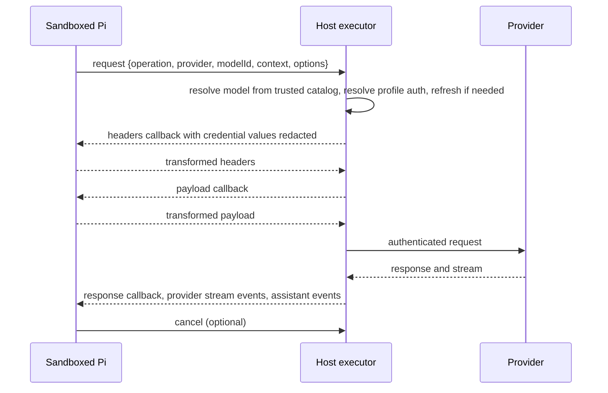

# Pi host credential executor

Status: slices 1, 2 and 4 implemented and tested in Nix builds on aarch64-darwin. Slice 4 replaced the original profile-library plan with credential references (below). The built launcher was also checked through real nono on rvn-mac with the real profile setup, without sending a model request. Not built for Linux. Slices 3, 5 and 6 are planned. Credential files remain readable and writable in every sandboxed session until slice 6.

## Goal

Sandboxed Pi must not be able to read reusable provider credentials. That covers Pi's own logins, API keys, and the credentials held by the `auth-profiles` extension. Pi must keep working with every provider that Pi supports, without per-provider configuration in the launcher.

The boundary is credential theft. A sandboxed session can still spend quota and act on the account through authorized requests. This plan does not change that.

## Decisions

- A host-side model executor runs Pi's own model runtime and makes every authenticated provider request. Sandboxed Pi sends model operations to it over a launcher-owned socket.
- A Pi source patch adds the remote mode inside `ModelRuntime`. The patch is active only when the launcher starts a sandboxed session.
- `pi --no-sandbox` is unchanged. It runs stock Pi code against the same credential files and the same profile rules.
- Credential files are denied in every sandboxed session, including sessions started inside `~/dotfiles` or `~/nixos`.
- `auth-profiles` stays unaware of the sandbox. In executor mode Pi's file-backed credential stores return credential references instead of secrets, provider auth runs on the executor, and requests carrying references go through the executor. The extension keeps choosing profiles and owners exactly as in raw mode. (This replaced the earlier plan to split the extension into a host-side library.)

### Rejected approaches

- Per-provider nono credential routes. Header injection cannot cover Codex JWT parsing, Copilot endpoint discovery, Bedrock signing, or new providers without a new adapter each time.
- nono OAuth capture. It keeps login and refresh orchestration inside the sandbox and does not protect credentials that already exist.
- `streamProxy` from `pi-agent-core` as a drop-in client. It forwards a fixed subset of options and drops the request callbacks that extensions depend on. Its event format, which strips the partial message and rebuilds it on the client, is a useful model for the wire protocol.
- A Pi extension that re-registers every provider with a proxying `streamSimple`. The override behavior for built-in auth and catalogs is unverified, and the extension would run inside the sandbox it is meant to constrain.

## Current state

### Credential exposure

- `modules/development/ai/nono/scripts/agent-protection.mjs:111` grants the existing `auth.json` file for in-place token refresh. `auth-profiles` is a writable runtime directory in the same module.
- `modules/development/ai/nono/scripts/profile.json` grants read access to `$HOME/.pi`.
- `modules/development/ai/nono/scripts/launcher.mjs:340` grants the whole agent directory in configuration-repository sessions.

The credential files are:

| Path | Contents |
|---|---|
| `~/.pi/agent/auth.json` | Default profile credentials |
| `~/.pi/agent/auth-profiles/<name>.json` | Credentials for each named profile |

`~/.pi/agent/auth-profiles.json` holds profile preferences only and can stay readable. `~/.pi/agent/mcp-auth.json` holds MCP OAuth state and is outside this plan.

### Pi request path

References are to the installed `pi-coding-agent/dist` files. The patch targets the matching TypeScript sources under `packages/coding-agent/src`, as the existing patches in `modules/development/ai/pi/` do.

- `core/model-runtime.js` sends `stream`, `streamSimple`, `streamDeferred`, `cancelDeferred`, `generateImages`, and `classify` through `prepareRequest(model, options)`. That method calls `getAuth`, merges auth headers, and passes the result to the provider implementation. This is the point where the remote mode forwards requests.
- `ModelRuntime.create` builds every runtime, including the one in the subagents extension's `child-session.ts`. Selecting the mode there covers child sessions.
- `core/sdk.js:208-290` attaches four callbacks to each request. `transformHeaders` runs the `before_provider_headers` event and receives the merged headers, including auth headers. `onPayload` runs `before_provider_request` and can rewrite the body. `onResponse` runs `after_provider_response`. `onProviderStreamEvent` runs `provider_stream_event`.

These callers read credentials outside `prepareRequest` today:

- `core/agent-session.js:233`, which checks auth before a request.
- `core/agent-session.js:275`, which passes `apiKey` and headers to a custom `streamFn`.
- `ModelRegistry.getApiKeyAndHeaders`, `getApiKeyForProvider`, and `getAuth`, which extensions can call.
- `modes/interactive/interactive-mode.js:4568` (Anthropic subscription warning), `modes/interactive/session-share.js:92`, and `modes/interactive/bug-report.js:123` (Radius token).
- `extensions/mcp/index.js:443`, where MCP servers can borrow a model provider's token through `providerToken`.
- `cli/credential-print.js` and `cli/auth-check.js`, behind `pi auth`.

### auth-profiles coupling

- `extensions/auth-profiles/index.ts:159-209` replaces Pi's private `runtime.credentials.store` with a composed profile store.
- `profile-credentials.ts` builds that store, including fallback order, pinned owners, and exhaustion state.
- `providers/anthropic-usage.ts:64` and `providers/openai-codex.ts:402` call `runtime.getAuth` to fetch usage.
- `profile-store.ts` reads credential files directly for `listProfiles`, `providersIn`, and `accountIdFor`.

### IPC

The launcher already spawns a host helper process for each IPC capability and grants its socket to the sandbox (`ipc-bootstrap.mjs`, `ipc-capabilities.json`). The existing `json-lines` backend allows one request per connection, 64 KiB frames, and second-scale timeouts. Model requests need long-lived streams, multi-megabyte frames, cancellation, and callbacks in both directions, so the executor needs a new backend.

## Design

### Components

1. **Pi patch.** When `PI_MODEL_EXECUTOR_SOCKET` is set, `ModelRuntime.create` returns a runtime that forwards model operations, credential operations, and catalog refresh to the executor. `getAuth` and the registry methods built on it return no credential in this mode. Custom `streamFn` auth injection fails with a clear error instead of reading credentials.
2. **Host executor.** A per-session helper started by the launcher before nono. It runs the patched Pi package's `ModelRuntime` with the profile library as its credential store. It reads `models.json` and provider settings from a snapshot taken before the sandbox starts.
3. **Streaming IPC backend.** A capability backend with framed messages, request IDs, cancellation, size limits suited to model contexts, and connection lifetime tied to the session.
4. **Profile library.** Profile resolution, the composed credential store, failover state, usage fetching, and reset credits, moved out of the extension. The extension keeps `/profile`, `/profiles status`, `/reset-credit`, UI, and session overrides.
5. **Sandbox policy.** Deny the credential files and their lock and backup paths in every session mode, and remove the overlapping `.pi` read grant.

### Protocol

Login follows the same channel. The executor runs the OAuth flow, including any local callback server and the PKCE verifier. The sandbox relays the authorization URL and user prompts. A pasted authorization code cannot be redeemed without the verifier, which stays on the host.

The sandbox receives metadata only. That means configured providers per profile, the active profile, availability, catalog entries, and usage status.

### Invariants

- The sandbox sends a provider ID and model ID, never a model object or provider configuration. The executor resolves `baseUrl`, headers, and API from its own catalog. Accepting a model object would let sandbox code redirect an authenticated request.
- No credential value crosses the socket. The executor redacts credential-bearing headers before the headers callback and strips them from errors and diagnostics.
- Header changes returned by the sandbox cannot add or replace credential headers. Whether sandbox-supplied headers may override auth headers needs a per-provider decision; the default is to reject such overrides.
- The executor loads code only from the Nix store. It does not load project extensions or code from the writable agent directory.
- Raw mode and the executor coordinate refresh through the same credential-store locks.

## Implementation slices

Each slice ends with passing tests and leaves the launcher deployable. The credential denial lands last, so earlier slices do not break existing sessions.

1. **Remote `streamSimple`.** Add the Pi patch for `streamSimple`, the streaming IPC backend, and a minimal executor with stock credential storage. Relay all four callbacks with header redaction. Gate the launcher behavior behind an option that defaults to off. Exit criterion: a synthetic provider server receives the synthetic credential, and the sandboxed client never observes it.

   Implemented as:

   - `pi-model-executor.patch` adds `core/model-executor.ts` (client, server, and wire protocol) and routes `ModelRuntime.streamSimple` to the executor when `PI_MODEL_EXECUTOR_SOCKET` is set. `executorSocket: null` forces local mode; the executor uses it.
   - The wire protocol is newline-delimited JSON, one request per connection, 64 MiB per frame. Structural events carry the whole partial message; text, thinking, and tool-call deltas carry only the delta, so streaming stays linear in output size. Closing the connection or sending `cancel` aborts the provider request.
   - The executor relays an allowlist of options. Endpoint-selecting provider options (for example `azureBaseUrl`, `region`, `project`), `apiKey`, `env`, `fetch`, and telemetry spans are not relayed. Credential-like header names are removed from sandbox-supplied headers and from headers returned by the sandbox's `transformHeaders`; the host's values always win. Credential values are scrubbed from every frame sent to the sandbox.
   - An unknown model triggers at most one catalog refresh per provider every five minutes on the host, then fails without contacting the provider.
   - `nono/scripts/model-executor.mjs` is the host helper; `model-executor-launch.mjs` starts it before nono when the invoking environment sets `PI_MODEL_EXECUTOR=1`. Its environment is the invoking host environment, not the project direnv environment, plus `PI_CODING_AGENT_DIR`. It drops `PI_LOCKFILE_DIR`, so it locks credential files the same way as `pi --no-sandbox`. The sandbox receives only `--allow-unix-socket` for the private endpoint under `~/.pi-ipc`. `pi --no-sandbox` drops any inherited `PI_MODEL_EXECUTOR_SOCKET`.

   Deviations from the original slice, each moved to slice 3: `stream()` stays local because API-specific options need per-API allowlists; requests with `deferred` stay local until fetch and cancel are relayed. Extension-registered providers stay local (see open questions). Executor startup adds roughly one second to sandboxed launch on rvn-mac.
2. **Credential lockdown inside Pi.** Make `getAuth`, `getApiKeyAndHeaders`, `getApiKeyForProvider`, custom `streamFn` injection, `pi auth`, session sharing, and the bug-report Radius path return no credential in remote mode. Replace the pre-request auth check with a remote check. Exit criterion: tests prove each listed caller gets no credential in remote mode and unchanged behavior in raw mode.

   Superseded by slice 4: `getAuth` returning nothing broke `auth-profiles` and any extension that makes its own authenticated requests. What remains: `pi auth` refuses to run when `PI_MODEL_EXECUTOR_SOCKET` is set. `getAuth` and `getApiKeyAndHeaders` now return credential references.
3. **Remaining operations.** Forward deferred responses, image generation, classification, catalog refresh, availability, `login`, `logout`, `setRuntimeApiKey`, and credential listing. Exit criterion: OpenRouter's personalized catalog and an OAuth login complete against local fake servers.
4. **Profile routing through credential references.** Implemented as:

   - `core/credential-refs.ts`: the executor's registry. Secret fields of stored credentials (names matching token, secret, key, access, refresh, password, credential), resolved API keys, and credential-like headers become `piref_` references, scoped to the provider that issued them. Refresh-token references can flow back into storage and OAuth refresh but never into a request.
   - `AuthStorage.create(path)` in executor mode returns an executor-held store. Reads return the file with references; writes take the host file lock, and references in the rewrite turn back into the stored secrets. A reference from another provider is rejected. The executor opens only `auth.json` and `auth-profiles/*.json` under its agent directory, after resolving symlinks.
   - Providers served by the executor have their auth methods (`apiKey.resolve`, `apiKey.check`, `oauth.refresh`, `oauth.toAuth`, logins) run on the executor. Pi's locked refresh flow therefore runs unchanged in the sandbox, and rotated tokens are written on the host.
   - Model requests send the sandbox's resolved auth, so the profile the sandbox chose is the one used. The executor swaps references back, accepts an auth `baseUrl` only on a known origin for that provider, and still resolves the model from its own catalog.
   - A process-wide `fetch` shim routes any request whose headers carry a reference through the executor. The executor sends it only to origins of that provider's catalog models or auth results, does not follow redirects, and scrubs the secrets from the response. This covers `auth-profiles` usage and reset-credit requests without changes to the extension.
   - Exit evidence: `pi/__tests__/model-executor.test.mjs` covers reference reads, profile-file routing, OAuth bearer requests, executor-side refresh with rotation persisted, write rehydration, origin and refresh-token restrictions, and the credential-file path policy.

   Still required before slice 6: `auth-profiles` reads credential files directly in four places (`providersIn`, `accountIdFor`, `readAnthropicCredential`, the OAuth check in `rotateAnthropicOwner`). They must read through Pi's credential store instead; that works the same in both modes. Requests that stay local in executor mode (`stream()`, deferred responses, images, classification) now carry references and reach providers only through the `fetch` shim, which buffers responses; slice 3 should move them to the executor.
5. **Trusted inputs.** Snapshot `models.json` and provider settings before launch. Package the profile library so the executor loads it from the Nix store. Exit criterion: a sandboxed edit to `models.json` or the extension source does not change what the running executor or the next executor does until the user reviews and activates it.
6. **Sandbox denial.** Deny the credential files in all session modes, remove the `auth.json` grant, and split the `.pi` read grant so it no longer covers credential paths. Exit criterion: kernel enforcement tests show reads and writes fail on Linux and macOS in both ordinary and configuration-repository sessions, and Pi still completes requests, refreshes, and logins.

## Testing

Tests go in `modules/development/ai/nono/__tests__/` and `modules/development/ai/pi/__tests__/`, following the existing layout. All tests use synthetic credentials, disposable homes, and local fake provider and OAuth servers. No test reads real credential files.

- Built-in providers with different auth shapes all complete through the executor. At minimum, test an API-key provider, Anthropic OAuth, OpenAI Codex, GitHub Copilot, OpenRouter, and Vercel AI Gateway. Slice 1 covers Anthropic with an API key and with OAuth.
- An Anthropic API-key profile (such as `ct`) and an Anthropic OAuth profile both reach the provider with their own credential: `x-api-key` for the key, `Authorization: Bearer` for OAuth, and no header injected by nono.
- The executor's provider traffic does not pass through nono's proxy. The launcher starts it outside nono, so nono's proxy variables and credential routes never apply to it.
- Extension callbacks see redacted headers, can rewrite payloads, and receive response headers and stream events.
- Expiry during concurrent sessions triggers one refresh, and the rotated refresh token is persisted. Cancelling a request during refresh does not lose the rotated token.
- Raw mode and sandboxed mode select the same profile for the same repository, host, and session override.
- A request naming an unknown model, a mismatched provider, or a sandbox-supplied `baseUrl` fails without contacting any upstream.
- Startup, `/reload`, session replacement, print mode, RPC mode, and subagent child sessions all use the executor.
- Tools inside the sandbox cannot read credential files, executor memory, or executor environment.

Runtime enforcement on real hosts and any live provider check need explicit approval.

## Rollout

The executor ships behind a launcher option that defaults to off. Once slices 1 through 5 pass on both platforms, enable the option on one host and keep the credential grants in place. Remove the grants (slice 6) only after a period of normal use without fallbacks.

Credential files keep their current location and format, so no migration is needed. Rollback means disabling the option and restoring the grants. Raw mode is unaffected throughout.

## Open questions

- How should the profile library reach the Nix store, given that `auth-profiles` lives in the separate dotfiles repository and is deployed with Stow?
- Should providers registered by extensions run inside the sandbox without protection, or only from a host-side allowlist?
- What replaces MCP `providerToken` access in sandboxed sessions?
- Which lock directory do raw mode and the executor share? The launcher sets `PI_LOCKFILE_DIR` for sandboxed sessions only, and `pi-runtime-locks.patch` has not been reviewed for this case. A sandbox-writable lock directory allows the sandbox to block refreshes but not to read credentials.
- Can any provider carry credentials in the request body, which the payload callback would expose? This needs checking per provider API. Slice 1 scrubs credential values from relayed payloads, so a payload returned unchanged by the sandbox keeps the placeholder where a credential appeared.
- The nono `anthropic` credential route intercepts every sandboxed connection to `api.anthropic.com` and injects the Claude CLI token. On macOS its capture helper reads only `~/.claude/.credentials.json`, but Claude CLI stores its login in the Keychain there, so capture fails and nono refuses the connection. With the executor, sandboxed Pi no longer connects to `api.anthropic.com`. Whether the route should stay host-wide or only serve Claude Bridge's local `/anthropic` route still needs a decision, and so does Keychain support for the capture helper.

## Remaining risks

- The Pi patch touches `model-runtime.ts`, `agent-session.ts`, `sdk.ts`, and `model-registry.ts`, which are central upstream files. Each Pi update will need the patch rebased and reviewed.
- Estimated size is roughly 500 to 800 lines for the Pi patch and 600 to 900 lines for the executor and IPC backend, plus the `auth-profiles` refactor. These are estimates from reading the code, not measurements.
- `docs/agents/pi-sandbox-policy.md` records unresolved `/proc` exposure and writable configuration-session persistence. This plan does not close those, so it is not complete same-user isolation.
